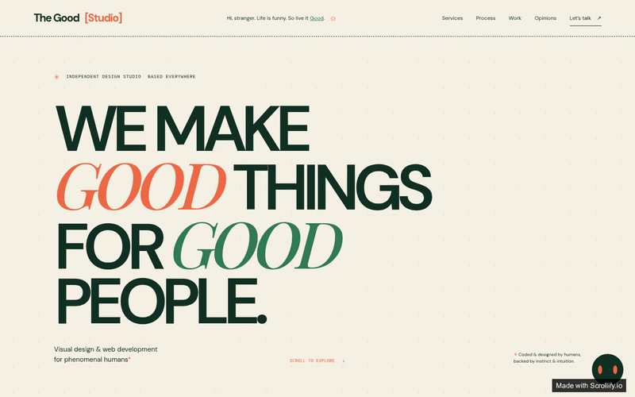

# The Good Studio

The Good Studio is an independent creative studio making thoughtful digital experiences for phenomenal humans. This portfolio introduces the studio, its services, selected work, process, client feedback, and ways to get in touch.

## What’s inside

- **Studio overview:** a bold editorial homepage with services and a guided look at the studio’s process.
- **Selected work:** a responsive portfolio gallery featuring image and video projects.
- **Client stories:** testimonials and a contact callout for prospective collaborators.
- **Contact page:** a dedicated inquiry form, alongside shared site navigation and footer.
- **Visual identity:** warm paper tones, deep and leafy greens, coral accents, and expressive typography.

## Built with

React, TypeScript, Tailwind_CSS, and GSAP.

## Project structure

- `src/data/`: editable studio content, services, testimonials, and portfolio media.
- `src/sections/`: homepage and contact page sections.
- `src/components/`: shared navigation and interactive UI components.
- `src/styles/`: global styles and brand tokens.
- `functions/`: Cloudflare Worker functions for server-side behavior.
- `public/`: local static assets.
